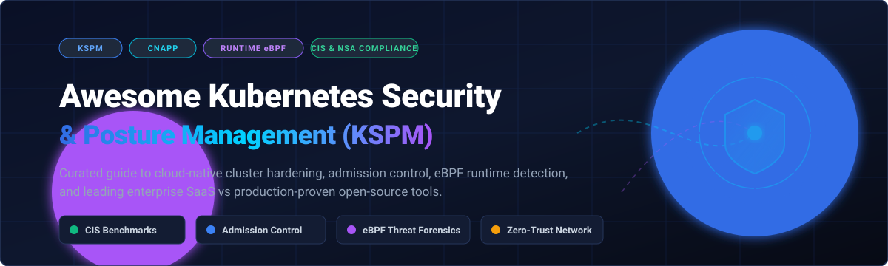

# 🛡️ Awesome Kubernetes Security & Posture Management (KSPM)

**A Curated Directory of Enterprise SaaS Platforms & Production-Ready Open-Source Tools for Kubernetes Security, Misconfiguration Auditing, Policy Enforcement & eBPF Runtime Threat Detection.**

*Focused on Cluster Hardening, Zero-Trust Workload Isolation, CIS & NSA-CISA Compliance, and DevSecOps Automation.*

📅 **Last updated: November 2026**

---

## 📑 Table of Contents

- [🌐 Sector Overview & Market Dynamics](#-sector-overview--market-dynamics)
- [🏢 Enterprise SaaS & Hosted KSPM Platforms](#-enterprise-saas--hosted-kspm-platforms)
- [🔓 Open-Source GitHub Projects](#-open-source-github-projects)
  - [Full KSPM & Workload Protection Platforms](#1-full-kspm--workload-protection-platforms)
  - [Policy Engines & Admission Controllers](#2-policy-engines--admission-controllers)
  - [Runtime Threat Detection & eBPF Forensics](#3-runtime-threat-detection--ebpf-forensics)
  - [Vulnerability & Security Auditing Tools](#4-vulnerability--security-auditing-tools)
  - [Zero-Trust Network Security & Service Mesh Policy](#5-zero-trust-network-security--service-mesh-policy)
- [🏗️ Architectural Recommendations & Zero-Cost Baseline](#-architectural-recommendations--zero-cost-baseline)
- [🤝 How to Contribute](#-how-to-contribute)
- [💖 Support](#-support)
- [📈 Star History](#-star-history)
- [⚖️ Disclaimer](#-disclaimer)

---

## 🌐 Sector Overview & Market Dynamics

The **Kubernetes Security and Posture Management (KSPM / CNAPP)** sector is estimated at **$3.2 billion in 2026** (growing at a ~21.5% CAGR as part of the broader cloud security market projected to exceed $30B by 2030). Market dynamics are **moderately concentrated among a tier of dominant multi-cloud CNAPP vendors** (such as Palo Alto Networks Prisma Cloud, Wiz, and CrowdStrike), while remaining **hyper-competitive at the container-native and eBPF layer** where specialized vendors (Sysdig, Aqua Security, ARMO) and open-source ecosystems (Kubescape, Falco, Cilium) maintain substantial architectural influence and technical differentiation.

---

## 🏢 Enterprise SaaS & Hosted KSPM Platforms

The table below catalogs leading commercial KSPM and CNAPP solutions, sorted in descending order by enterprise market size (market capitalization or private valuation).

| Platform / Vendor | Company Scale (Valuation / Market Cap) | Starting Tier Pricing | Free Tier / Trial Limit | Key Capabilities & Architecture |
| :--- | :--- | :--- | :--- | :--- |
| **[Prisma Cloud (Palo Alto Networks)](https://www.paloaltonetworks.com/prisma/cloud)** 🛡️ | **~$108 Billion** (Public: NASDAQ:PANW) | Starting at **$360/credit/year** (~$0.04/credit-hour consumption model via AWS/Azure Marketplace) | **30-day full-feature trial**, up to 50 cloud accounts / 250 workload credits | Unified enterprise CNAPP covering cluster posture, runtime agent defense, compliance governance, and vulnerability management across hybrid & multi-cloud Kubernetes. |
| **[CrowdStrike Falcon Cloud Security](https://www.crowdstrike.com/)** 🦅 | **~$74 Billion** (Public: NASDAQ:CRWD) | Starting at **$150–$215/cloud instance/year** (Falcon Cloud Workload Protection starting pack) | **15-day free trial** with access to the Falcon Cloud Security console for up to 20 workloads | Unified Falcon sensor and agentless cluster scanning; native detection of container escapes, malicious syscalls, and NSA/CISA posture drift. |
| **[Datadog Container Security](https://www.datadoghq.com/)** 🐶 | **~$42 Billion** (Public: NASDAQ:DDOG) | Starting at **$3.00/host/month** (CSM Pro add-on to core agent) or **$7.50/host/month** for full CSM Enterprise | **14-day free trial** with full access to Cloud Security Management and APM across unlimited containers | Deep integration with Datadog observability; continuous configuration audits against CIS benchmarks, workload vulnerability scanning, and eBPF network telemetry. |
| **[Wiz](https://www.wiz.io/)** 🧙‍♂️ | **~$12 Billion** (Private valuation) | Starting at **~$15,000–$25,000/year** base enterprise contract (typically ~$18–$30/workload/month) | **30-day guided enterprise POC/trial** on selected production or staging cluster environments | 100% agentless CNAPP utilizing deep Kubernetes graph queries; maps attack paths connecting misconfigured RBAC, exposed secrets, vulnerable images, and internet exposure. |
| **[Red Hat Advanced Cluster Security / StackRox](https://www.redhat.com/en/technologies/cloud-computing/openshift/advanced-cluster-security-kubernetes)** 🎩 | **~$34 Billion** (Red Hat / IBM subsidiary) | Starting at **~$1,200/node/year** (or bundled with Red Hat OpenShift Platform Plus subscriptions) | **60-day self-managed evaluation trial** with full RHACS cluster licenses | Kubernetes-native architecture built on StackRox; enforces declarative admission control policies, deep network segmentation analysis, and vulnerability mitigation. |
| **[Aqua Security](https://www.aquasec.com/)** 💧 | **~$3 Billion** (Private valuation) | Starting at **$2.50/workload/month** (Aqua Cloud Native Security starter) or **$1,500/month** developer baseline | **14-day full platform free trial** (unlimited cluster scans during trial window) | Container and cluster security pioneer; powers runtime drift prevention, memory injection blocking, immutable container enforcement, and embedded Trivy malware/CVE scanning. |
| **[Orca Security](https://orca.security/)** 🐋 | **~$1.8 Billion** (Private valuation) | Starting at **~$12,000–$18,000/year** base deployment (~$15–$25/asset/month) | **30-day free trial** covering up to 500 cloud assets / container workloads | SideScanning-driven agentless visibility; instant posture analysis of Kubernetes nodes, kube-apiserver configs, workloads, and identity privileges without agent overhead. |
| **[Sysdig Secure](https://sysdig.com/)** 🔍 | **~$1.5 Billion** (Private valuation) | Starting at **$2.40/agent/day** (~$72/host/month) or **$0.01/container-hour** Pay-as-you-go | **30-day free trial** with full runtime threat detection, eBPF activity capture, and vulnerability management | Built by the creators of Falco; delivers deep eBPF runtime forensics, syscall capture, CI/CD image scanning, and real-time MITRE ATT&CK incident reconstruction. |
| **[Tigera Calico Cloud](https://www.tigera.io/)** 🐯 | **~$500 Million** (Private valuation) | Starting at **$0.08/node-hour** (~$58/node/month on Pay-As-You-Go) | **14-day free trial** with access to managed Calico Cloud console for up to 5 clusters | Enterprise network security and microsegmentation platform; dynamic packet inspection, wireguard encryption, egress gateway security, and anomaly detection. |
| **[ARMO Platform](https://www.armosec.io/)** 🛡️ | **~$70 Million** (Private valuation) | Starting at **$19/worker-node/month** (Team Tier) | **Free Forever tier** for up to 3 clusters and 10 worker nodes (unlimited scans) | Commercial enterprise platform behind Kubescape; combines automated posture management with eBPF Cloud Application Detection & Response (CADR) and continuous attack-surface reduction. |

---

## 🔓 Open-Source GitHub Projects

The table below ranks open-source projects across the cloud-native ecosystem by popularity (GitHub Star count, descending). Every tool includes a direct link to inspect its community stargazers.

| Project & Repo | GitHub Stars | Primary Domain | Core Features & Architecture |
| :--- | :--- | :--- | :--- |
| **[aquasecurity/trivy](https://github.com/aquasecurity/trivy)** 🔍 |  | Vulnerability & Config Audit | All-in-one comprehensive scanner: detects CVEs, IaC misconfigurations, exposed secrets, software licenses, and Kubernetes workload posture issues. |
| **[cilium/cilium](https://github.com/cilium/cilium)** 🐝 |  | eBPF Network & Security | CNCF Graduated eBPF networking engine; enforces L3/L4 and L7 API security policies, identity-aware encryption, and transparent cluster observability via Hubble. |
| **[open-policy-agent/opa](https://github.com/open-policy-agent/opa)** 📜 |  | General Policy as Code | CNCF Graduated declarative policy engine; decouples security policies from application code using the expressive Rego query language. |
| **[kubescape/kubescape](https://github.com/kubescape/kubescape)** 🛡️ |  | Full KSPM & CADR Platform | CNCF Incubating complete KSPM platform; cluster posture audits (NSA-CISA, CIS, MITRE), automated remediation (`kubescape fix`), image patching via Copacetic, and eBPF runtime threat detection. |
| **[falcosecurity/falco](https://github.com/falcosecurity/falco)** 🦅 |  | Runtime Threat Detection | CNCF Graduated de facto runtime security standard; parses Linux kernel syscalls via eBPF to detect anomalous behaviors, privilege escalation, and container escapes in real time. |
| **[kyverno/kyverno](https://github.com/kyverno/kyverno)** ⚙️ |  | K8s Admission Control | CNCF Incubating Kubernetes-native policy engine; validate, mutate, generate, and verify resources using intuitive YAML syntax without requiring Rego. |
| **[aquasecurity/kube-bench](https://github.com/aquasecurity/kube-bench)** 📋 |  | CIS Benchmark Auditing | Audits Kubernetes nodes, control plane configurations, and worker nodes strictly against the official CIS Kubernetes Benchmark standards. |
| **[projectcalico/calico](https://github.com/projectcalico/calico)** 🐯 |  | Network Security & CNI | Highly scalable container networking and network security; features GlobalNetworkPolicies, WireGuard node encryption, host protection, and BGP peering. |
| **[tenable/terrascan](https://github.com/tenable/terrascan)** 🔍 |  | Static IaC & Manifest Security | Static code analyzer scanning Kubernetes YAML manifests, Helm charts, Terraform, and Kustomize for posture violations before cluster deployment. |
| **[aquasecurity/tracee](https://github.com/aquasecurity/tracee)** 🔬 |  | eBPF Tracing & Forensics | Lightweight eBPF-based event tracer and forensic security monitor; tracks system calls, process executions, network interactions, and file integrity violations. |
| **[open-policy-agent/gatekeeper](https://github.com/open-policy-agent/gatekeeper)** 🐊 |  | Admission Policy Webhook | Production-grade Kubernetes admission controller integrating OPA with native CRDs (ConstraintTemplates & Constraints) for cluster-wide governance. |
| **[FairwindsOps/polaris](https://github.com/FairwindsOps/polaris)** 🧭 |  | Configuration Auditing | Validates and remediates cluster deployments against best practices covering resource requests/limits, health checks, and Pod Security Standards. |
| **[Shopify/kubeaudit](https://github.com/Shopify/kubeaudit)** 🛍️ |  | Audit & Auto-Remediation | CLI tool and audit utility developed by Shopify; discovers security oversights (e.g., privilege escalation, missing root restrictions) with automated manifest fixes. |
| **[stackrox/stackrox](https://github.com/stackrox/stackrox)** 🎩 |  | Open-Source Security Platform | Open-source core of Red Hat Advanced Cluster Security (RHACS); delivers continuous compliance monitoring, deployment risk profiling, and admission control. |

---

### Detailed Breakdown of Open-Source Categories

#### 1. Full KSPM & Workload Protection Platforms
* **[Kubescape](https://github.com/kubescape/kubescape)**: The standout open-source KSPM suite. Integrates with IDEs, CI/CD pipelines, and runtime clusters. Out of the box, it checks for NSA-CISA, MITRE ATT&CK, and CIS benchmarks. Features auto-remediation (`kubescape fix`), container image patching via Copacetic, and eBPF-driven runtime threat detection with minimal CPU footprint.
* **[StackRox](https://github.com/stackrox/stackrox)**: Kubernetes-native platform providing security policy enforcement across cluster deployments, risk profiling, vulnerability management, and declarative policies.

#### 2. Policy Engines & Admission Controllers
* **[Kyverno](https://github.com/kyverno/kyverno)**: Kubernetes-native policy management without the learning curve of complex query languages. Policies are expressed purely in YAML, enabling rapid adoption for platform teams.
* **[OPA / Gatekeeper](https://github.com/open-policy-agent/gatekeeper)**: CNCF standard for advanced, enterprise-grade admission control. Utilizes Rego for complex multi-resource validations, context-aware audits, and cross-namespace constraints.

#### 3. Runtime Threat Detection & eBPF Forensics
* **[Falco](https://github.com/falcosecurity/falco)**: The industry benchmark for Linux and Kubernetes runtime monitoring. Monitors syscalls directly from the kernel to detect behavioral anomalies, unauthorized file modifications, reverse shells, and privilege escalations.
* **[Tracee](https://github.com/aquasecurity/tracee)**: High-performance eBPF engine designed to capture system events, extract security telemetry, and detect advanced exploit techniques in real time.

#### 4. Vulnerability & Security Auditing Tools
* **[Trivy](https://github.com/aquasecurity/trivy)**: Comprehensive scanner for container images, Git repositories, virtual machine filesystems, and Kubernetes manifests.
* **[kube-bench](https://github.com/aquasecurity/kube-bench)**: Go application checking whether Kubernetes is configured following the Center for Internet Security (CIS) Kubernetes Benchmark recommendations.
* **[Polaris](https://github.com/FairwindsOps/polaris)**: Audits cluster workloads for common misconfigurations, reliability gaps, and security anti-patterns.
* **[kubeaudit](https://github.com/Shopify/kubeaudit)**: Auditing command-line tool capable of auto-generating corrective patches for Kubernetes YAML manifests.
* **[Terrascan](https://github.com/tenable/terrascan)**: 500+ built-in policies testing infrastructure as code (IaC) against CIS benchmarks to catch misconfigurations before deployment.

#### 5. Zero-Trust Network Security & Service Mesh Policy
* **[Cilium](https://github.com/cilium/cilium)**: Revolutionized Kubernetes networking and security via eBPF. Eliminates IP-based iptables bottlenecks with label-based identity filtering, transparent TLS encryption, and Layer 7 protocol filtering.
* **[Calico](https://github.com/projectcalico/calico)**: Industry standard CNI providing fine-grained network policies, BGP interconnectivity, host endpoint security, and cross-cluster encryption.

---

## 🏗️ Architectural Recommendations & Zero-Cost Baseline

When architecting a production Kubernetes security posture without commercial license overhead, adopt this battle-tested open-source stack:

1. **Pre-Commit & CI/CD Pipeline**: Run **[Trivy](https://github.com/aquasecurity/trivy)** to scan container images for known vulnerabilities and evaluate Kubernetes manifests with **[Terrascan](https://github.com/tenable/terrascan)**.
2. **Admission Control Gate**: Deploy **[Kyverno](https://github.com/kyverno/kyverno)** to enforce non-root execution, verify digital signatures (Cosign), and block unapproved registries before pods enter the cluster.
3. **Cluster Hardening & CIS Compliance**: Schedule regular **[kube-bench](https://github.com/aquasecurity/kube-bench)** jobs to validate node configs alongside continuous scans by **[Kubescape](https://github.com/kubescape/kubescape)**.
4. **Network Microsegmentation**: Implement **[Cilium](https://github.com/cilium/cilium)** or **[Calico](https://github.com/projectcalico/calico)** to mandate default-deny pod communication policies and isolate sensitive namespaces.
5. **Kernel Runtime Monitoring**: Run **[Falco](https://github.com/falcosecurity/falco)** across all nodes to alert security response teams to runtime anomalies and unexpected binary executions.

---

## 🤝 How to Contribute

Contributions, updates, and corrections are warmly welcomed! 

1. **Fork** the repository.
2. Create a new branch: `git checkout -b feature/add-new-kspm-tool`.
3. Add the project or platform to the relevant table/section with verified links, pricing/stars, and architectural details.
4. Verify all markdown links and badge rendering.
5. Submit a **Pull Request** detailing your additions.

⭐ **If you find this directory valuable, please star this repository!**

---

## 💖 Support

Thank you for visiting and supporting the **Awesome Kubernetes Security & Posture Management** repository!

If you find this curated resource helpful for your work, team, or cloud-native infrastructure, please consider supporting the project:

- ⭐ **Star this repository** to show your appreciation and help other engineers discover it.
- 🍴 **Fork and contribute** by adding new tools, updating benchmarks, or fixing data.
- 📢 **Share** this list with colleagues, DevSecOps communities, and Kubernetes practitioners.
- ☕ **Buy a coffee / Sponsor the maintainer**: Support continued curation and open-source maintenance via the [GitHub Sponsors Dashboard](https://github.com/sponsors/ishandutta2007).

---

## 📈 Star History

---

## ⚖️ Disclaimer

- This repository is a curated community directory and does not constitute an explicit commercial endorsement of any product or service.
- Product valuations, market capitalizations, and software pricing tiers reflect prevailing industry data as of late 2026 and are subject to change.
- Deploying security agents and admission webhooks into live Kubernetes clusters requires rigorous validation in non-production environments to avoid accidental service interruption.

---

  <b>Built with ❤️ for platform engineers, DevSecOps practitioners, and Kubernetes cluster administrators.</b>

